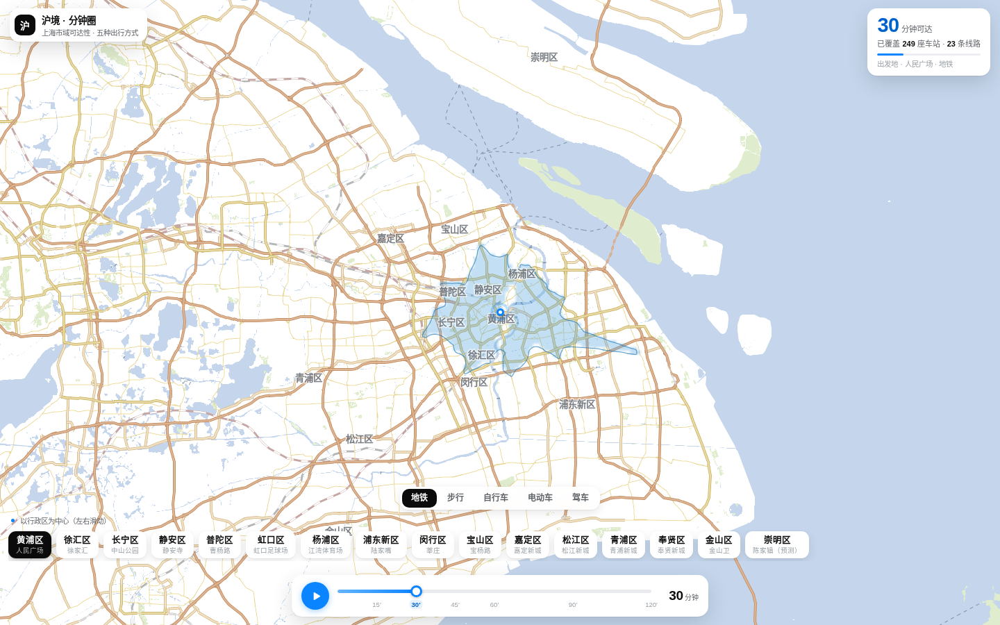

# 上海出行圈 · Shanghai Commute Circle

以任意地点为起点，沿真实路网逐分钟扩散，直观看到「多少分钟能到哪」——支持地铁、步行、自行车、电动车、驾车五种出行方式。



## 在线访问

启用 GitHub Pages 后可直接打开：

```
https://JamesZhao-11.github.io/shanghai-commute-circle/
```

## 功能

- **五种出行方式**：地铁、步行、自行车、电动车、驾车，可随时切换，各自的耗时时速不同，圈形也完全不同
- **分钟圈动画**：选定出发地，用时间轴滑块或播放键，看可达范围按分钟一圈圈铺开
- **真实网络扩散**：不是画圆，而是沿路网 / 轨道拓扑逐点推进，换乘与站间耗时都算进去
- **出发地快选**：按行政区列出主要点位（黄浦、徐汇、静安、浦东新区……），一键切换
- **键盘操作**：空格播放 / 暂停，`←` `→` 逐分钟调节
- **实时统计**：随分钟数增长，同步显示已覆盖站点数与线路数

## 本地运行

单文件页面，无构建步骤、无依赖安装：

```bash
python3 -m http.server 8000
# 打开 http://localhost:8000
```

直接双击 `index.html` 也能跑。

## 技术说明

- 纯静态单文件 `index.html`（约 3.8 MB），Leaflet 内联打包，路网与站点数据全部内嵌，不依赖 CDN
- 底图瓦片走在线地图服务，需联网
- 无后端、无追踪、无 cookie

## 来源

本仓库为其 GitHub Pages 发布版本，已移除平台注入脚本与内部标记，内容保持一致。
